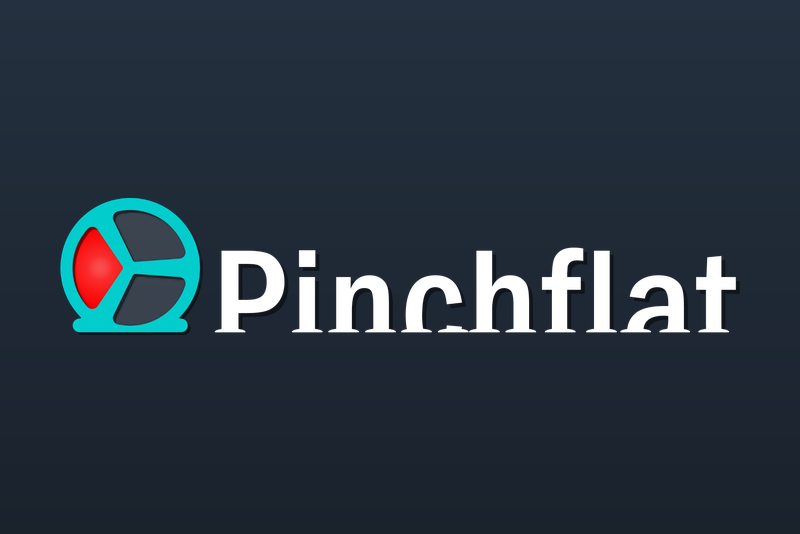

# Pinchflat for Gladys Assistant

An external integration for [Gladys Assistant](https://gladysassistant.com) that
brings a [Pinchflat](https://github.com/kieraneglin/pinchflat) server (the
self-hosted downloader of YouTube channels and playlists, based on yt-dlp) into
Gladys, over the local network.



## What it does

- **One device**: online, videos downloaded today, pending videos, videos in
  error, sources followed, videos downloaded in total, and the last video
  downloaded (title and source, as text).
- **Scene triggers**: a new video was downloaded (source, title, upload date,
  link to its page in Pinchflat), a download failed (with the yt-dlp error).
  Both can be filtered on a source.
- **Scene action**: read the latest videos, a sentence for a message or a voice
  announcement, with the figures separately.
- **Dashboard widget**: downloaded today, pending, in error, and the list of the
  latest videos downloaded.
- Read only: nothing is ever changed in Pinchflat.

The user documentation, in English, French, German and Spanish, is in
[`docs/`](docs/en.md) and is shown by Gladys.

Tested against a real Pinchflat 2025.9.26 (the official Docker image,
downloading a real video from YouTube), not yet in a real Gladys installation:
feedback welcome on the [Gladys forum](https://community.gladysassistant.com) or
in the [issues](https://github.com/guim31/gladys-pinchflat/issues).

## Requirements

- Gladys Assistant 5.1.0 or later.
- A Pinchflat server reachable from Gladys, on the port of its web interface
  (`8945` by default).
- When its interface is protected (`BASIC_AUTH_USERNAME` /
  `BASIC_AUTH_PASSWORD`): that user name and password.

## Installation

In Gladys: **Integrations** → **Install from GitHub**, with the address of this
repository: `https://github.com/guim31/gladys-pinchflat`. Then enter the address
of Pinchflat in the configuration, and add the device from the **Discover** tab.

## How it works

Pinchflat has no REST API. Its RSS feeds only list the downloaded videos of one
source (no queue, no error), and its Apprise notifications would need an inbound
port, which the sandbox of Gladys does not open. So the integration reads the
pages of the web interface, with plain GET requests, at the chosen interval (2
minutes by default):

- `/sources`: the first 10 sources (the table is paginated through the
  LiveView websocket only) with their counts, and the version of Pinchflat;
- beyond 10 sources, `/media_profiles` and `/media_profiles/<id>`: the list of
  every source;
- `/sources/<id>`: the 10 latest pending videos (with the download errors), the
  10 latest downloaded, and the counts of the source. Read when the counts of a
  source of the first page moved, when it was never read, every 15 minutes
  while it has pending videos, and in turn for the sources beyond the first
  page; at most 10 pages per reading.

Phoenix LiveView renders these tables on the server at the first request, so the
HTML holds the data. The ids of the videos already seen are kept under `/data`:
a video is announced once, even after a restart, and what Pinchflat had before
is never announced. Only the changes are sent to Gladys.

## Limits

- One Pinchflat server per integration. Read only.
- Pinchflat lists the downloaded videos by upload date: an old video downloaded
  late (the backfill of a new source) is counted, without a scene event.
- Errors are read in the 10 latest pending videos of each source, within 15
  minutes.
- The pages of Pinchflat are not a stable API: a future version that changes
  them may need an update of the integration (the tests pin the markup of
  2025.9.26).

## Development

```bash
npm ci
npm run format:check && npm run lint && npm test
npx -y github:GladysAssistant/integration-store --skip-image-check .
```

The tests run against the fake Gladys of the SDK and an in-memory Pinchflat that
renders the markup of the real pages (`test/fixtures/pinchflat/`, captured from
Pinchflat 2025.9.26). See [`CLAUDE.md`](CLAUDE.md) for the architecture and the
pitfalls.

## Credits

- [Pinchflat](https://github.com/kieraneglin/pinchflat) by Kieran Eglin
  (AGPL-3.0). The logo of the cover comes from its official repository
  ([`priv/static/images/originals/logo-white-wordmark-with-background.png`](https://github.com/kieraneglin/pinchflat/tree/master/priv/static/images/originals)).
  No code of Pinchflat is copied: the integration only reads its web pages.
- Built on the official
  [integration template](https://github.com/GladysAssistant/integration-template-js)
  and SDK of Gladys Assistant.

Not affiliated with Pinchflat, YouTube or Google. Licensed under the
[Apache License 2.0](LICENSE).
